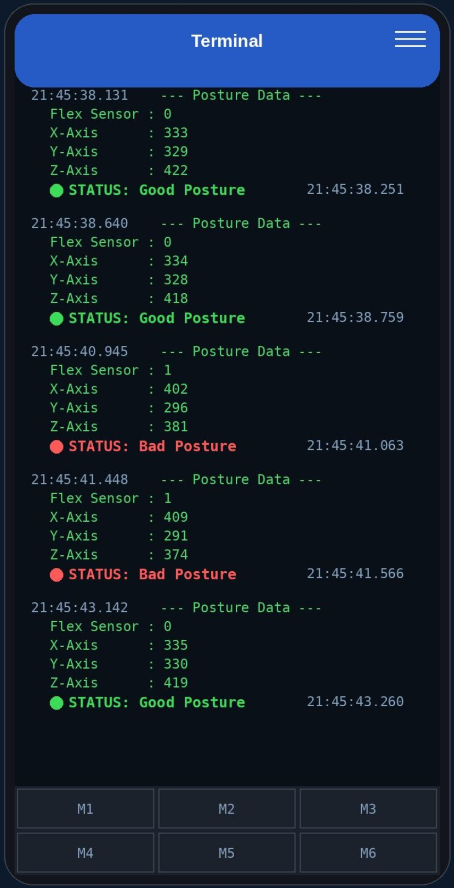

# Smart Posture Monitor

A wearable posture monitor that detects slouching with a flex sensor and an accelerometer, and sends live readings and alerts to a phone over Bluetooth.

Embedded Systems course project, Taif University, June 2026.

## The problem

Long hours at a desk train the body into a slouched position, and the longer that lasts the harder it is to correct. This project is a low-cost wearable that checks spinal posture continuously and tells the user the moment they start to slouch.

## How it works

1. **Sense.** A flex sensor runs along the spine and changes resistance as it bends. An ADXL335 accelerometer adds X/Y/Z orientation.
2. **Process.** An Arduino UNO reads both sensors and compares the bend reading against a threshold.
3. **Transmit.** An HC-05 Bluetooth module sends the readings and posture status to the phone.
4. **Alert.** The Serial Bluetooth Terminal app on Android shows the live data and flags bad posture.

## Hardware

| Part | Details |
| --- | --- |
| Arduino UNO | ATmega328, 16 MHz |
| Flex sensor | SEN-08606, 4.5 in, 10K flat, 60K to 110K bent |
| Accelerometer | ADXL335, 3-axis analog |
| Bluetooth | HC-05 |
| Resistor | 10K, voltage divider for the flex sensor |

Wiring:

| From | To (Arduino) |
| --- | --- |
| Flex sensor pin 1 | 5V |
| Flex sensor pin 2 | A4, and through 10K to GND |
| ADXL335 X_OUT | A1 |
| ADXL335 Y_OUT | A2 |
| ADXL335 Z_OUT | A3 |
| HC-05 RXD | D4 |
| HC-05 TXD | D5 |

## Results

Upright posture was set as the 0 baseline, and a bend reading above 300 was treated as slouching. Across repeated trials the device tracked the change in real time and raised the alert every time the threshold was crossed.

Live output in the Bluetooth terminal during testing:

## Files

| File | What it is |
| --- | --- |
| `firmware/posture_monitor/posture_monitor.ino` | Arduino sketch |
| `docs/report.pdf` | Project report |
| `figures/` | Terminal output from testing |

## Running it

1. Wire the circuit as in the table above.
2. Open `posture_monitor.ino` in the Arduino IDE and upload it to the UNO.
3. Sit upright while it calibrates for a second at startup.
4. Pair the phone with the HC-05, open Serial Bluetooth Terminal, and connect.

The sketch was rewritten after the project from the documented wiring and output format. `BEND_THRESHOLD` may need adjusting for a different sensor or mounting.

## Future improvements

- Monitor dynamic activities such as walking or running
- Log data wirelessly to a PC or cloud platform for long-term trends
- Shrink the hardware into a more comfortable wearable
- Extend monitoring beyond the spine

## Author

Reema Khalid Al-boqami, Computer Engineering, Taif University
